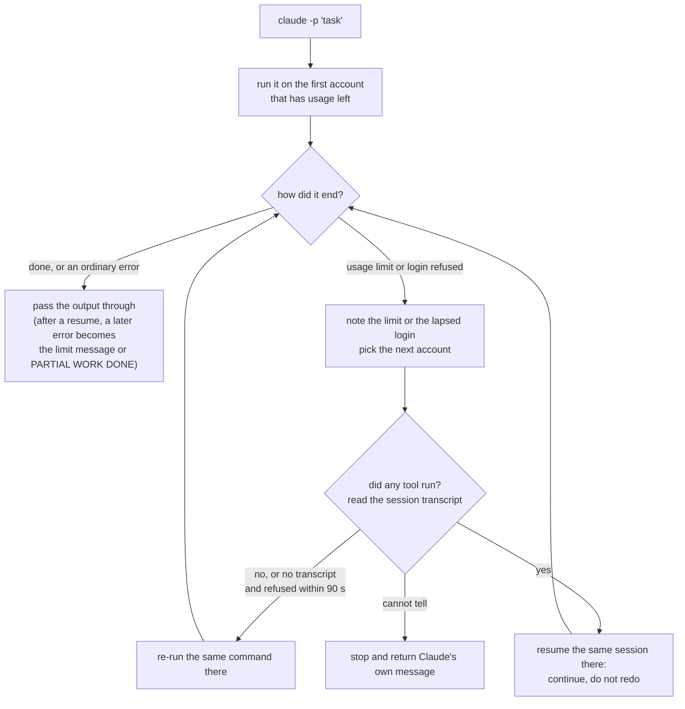

# claude-failover

Keep Claude Code working when an account hits its usage limit: automatic failover across your own accounts, with every chat and its full history carried over.

[](https://github.com/aarushkandukoori/claude-failover/actions/workflows/tests.yml)
[](LICENSE)




<sub>Real output of `scripts/make_demo.py`, which runs the tool against a fake `claude` binary in a throwaway sandbox.</sub>

## The problem

Claude subscription plans have usage limits: one that resets every few hours and a weekly one. When an account hits a limit, Claude Code stops: scheduled `claude -p` jobs fail and the chat you are in cannot go on, even if another account of yours still has usage left. Switching by hand means logging out and in again, and the desktop app only lists the chats of the account it is signed in to.

## What it does

- **Headless failover without doing work twice** - `claude -p` runs try your accounts in order. When an account is refused by a usage limit or a lapsed login, the run moves to the next one: a fresh re-run if no tool ran yet, otherwise a resume of the same session that continues where it stopped.
- **Chat handoff through a StopFailure hook** - when a chat in the desktop app or in Terminal hits a limit, a Claude Code hook opens Terminal and continues the same conversation, with its full history, on the next account.
- **Desktop chat sync across accounts** - the desktop app lists Code chats per account. `claude-accounts sync` copies each chat's record to every account, so every account lists every chat.
- **Login-expiry early warning and an optional spare token** - CLI logins expire, and headless jobs never see Claude's warning. `claude-accounts status` says when each login ends and when to renew it. An optional one-year spare token keeps headless runs going if a login lapses anyway.
- **Drop-in** - same arguments, same output, same exit codes, so scripts keep calling `claude`. One difference is on purpose: a `-p` run that names no permission mode gets `--permission-mode default`, so a `permissions.defaultMode` in `settings.json` does not reach headless jobs. Pass `--permission-mode` in a script that needs another mode.

## In daily use

On the author's Mac from Oct 8 to Nov 9, 2026, the wrapper handled about 12,550 headless runs. It moved 293 of them to another account: 292 because that account's login had lapsed and 1 because of a usage limit. The hook handed off 6 desktop chats that hit a usage limit.

## How it works

Each account gets its own Claude Code config folder (`CLAUDE_CONFIG_DIR`, for example `~/.claude-work`), so each one has its own login. The shared items in that folder (transcripts, memory, settings, skills) are symlinks to `~/.claude`, so any account can resume any conversation with its full history.

`bin/claude-failover` stands in for the `claude` binary. A chat starts on the first account in your chat order that is not limited. A `-p` run goes through this loop:



A chat that hits a limit goes the same way through the hook, which runs `claude --resume <id> --fork-session` on the next account in a new Terminal window. The full design, with every edge case, is in [docs/ARCHITECTURE.md](docs/ARCHITECTURE.md). Desktop sync has its own page: [docs/DESKTOP-SYNC.md](docs/DESKTOP-SYNC.md).

It is plain Python 3.9 standard library, run by the system `/usr/bin/python3`. There is nothing to install with pip.

```
bin/claude-failover        the wrapper, a drop-in for claude
bin/claude                 the same wrapper under the name claude, for PATH
bin/claude-failover-hook   the StopFailure hook
bin/claude-accounts        setup and status
claude_failover.py         wrapper, hook and claude-accounts logic
desktop_sync.py            desktop chat sync
tests/                     unittest suite, fake claude binary, fake keychain tool
docs/                      architecture and desktop sync write-ups
```

## Quick start

You need macOS, Claude Code, and two or more Claude accounts of your own. `/usr/bin/python3` comes with the Xcode Command Line Tools (`xcode-select --install`).

```bash
git clone https://github.com/aarushkandukoori/claude-failover.git
cd claude-failover
./install.sh                     # links claude-accounts and claude-failover into ~/.local/bin

claude-accounts add personal --email you@example.com
claude-accounts add work --email you@work.example
claude-accounts login personal   # a browser opens: sign in as that account
claude-accounts login work
claude-accounts hook install     # a chat that hits a limit continues on the next account
claude-accounts sync install     # optional: desktop app chats on every account (sign the desktop app into each account once first)
claude-accounts status
```

Then point your scripts at `claude-failover` instead of `claude`. Or put the repo's `bin/` folder first on your `PATH` (`install.sh` prints the exact line for `~/.zshrc`): its `claude` shim sends every plain `claude` started from your shell through the wrapper, scripts included. Jobs started by launchd or cron do not read `~/.zshrc`, so call `claude-failover` there by its full path. Until you add an account, the wrapper runs `claude` exactly as it is.

The config lives at `~/.config/claude-failover/config.json`. [config.example.json](config.example.json) shows the usual keys, and the [configuration table](docs/ARCHITECTURE.md#configuration) explains every key.

To remove it: `claude-accounts hook uninstall`, `claude-accounts sync uninstall`, then `./install.sh --uninstall`. Your config, state and logins are kept.

## Commands

| Command | What it does |
|---|---|
| `claude-failover <claude arguments>` | Runs `claude` on the right account. `bin/claude` is the same command. |
| `claude-accounts status [--json]` | Each account: logged in or not, limited until when, when to renew its login. With desktop sync on, one more line about desktop chats. |
| `claude-accounts init [--force]` | Write a starter config to `~/.config/claude-failover/config.json` (or to `$CLAUDE_FAILOVER_CONFIG` when set). `--force` starts the config in use over, after a backup. |
| `claude-accounts add <name> [--email E] [--config-dir DIR]` | Add an account and create its folder, linked to `~/.claude`. |
| `claude-accounts setup` | Create and link every account folder again. |
| `claude-accounts login <account>` | Sign an account in through the browser and start its login clock. |
| `claude-accounts logged-in <account> [YYYY-MM-DD]` | Date a login made some other way, such as `/login` inside a chat. |
| `claude-accounts token <account>` | Save a one-year spare token for headless runs in the keychain. |
| `claude-accounts test [account]` | One tiny call per account, and per spare token. |
| `claude-accounts clear [account]` | Forget saved limits. |
| `claude-accounts mark <account> [minutes]` | Mark an account as limited by hand. |
| `claude-accounts log [n]` | Show the last n events. |
| `claude-accounts argspec` | Re-read the option table from the installed `claude` after an update. |
| `claude-accounts hook install\|uninstall\|status` | Manage the StopFailure hook in `~/.claude/settings.json`. |
| `claude-accounts sync [--dry-run] [--quiet] [--json]` | Sync desktop app chats once. |
| `claude-accounts sync install [--every MINUTES]`, `sync uninstall`, `sync status` | Sync in the background with a LaunchAgent, every 10 minutes by default. |

For a single call, `CLAUDE_FAILOVER_ACCOUNT=<name>` pins one account, `CLAUDE_FAILOVER=off` turns failover off and uses the first account of the chat order, and `CLAUDE_FAILOVER_VERBOSE=1` prints failover notes on stderr. Every variable is listed in [docs/ARCHITECTURE.md](docs/ARCHITECTURE.md#configuration).

## Design guarantees

- **Never runs a task twice** - before it moves a run, the wrapper reads that run's transcript. It re-runs the command only when no tool call happened, or when there is no transcript and the refusal came within 90 seconds of the start. Otherwise it resumes the same session and tells the model to continue without repeating finished steps. When it cannot verify what happened, it does not move the run and returns Claude's own message (the usage limit or the login error). That covers runs with `--no-session-persistence` (no transcript), runs with `-c`/`--continue` (the session is not known in advance), resumes that would need a command-line option the wrapper does not know, and accounts whose folder kept its own `projects` instead of the link to `~/.claude/projects` (the wrapper cannot see their transcripts; `claude-accounts add`, `setup` and `status` name such folders). If a resumed run then fails for another reason, the caller never sees that unrelated error, which could invite a blind retry. It gets the original limit message, or a `claude-failover: PARTIAL WORK DONE` line that asks for a check before running the task again.
- **Never reads or copies your logins** - logins stay in the macOS keychain, where only `claude` itself uses them. The one secret the tool reads is the optional spare token. It is fetched from the keychain when a headless run's login is refused, and for the test calls of `claude-accounts token` and `claude-accounts test`. It is handed to `claude` in its environment and never written to disk.
- **Never deletes a chat on its own** - desktop sync never touches transcripts. It removes a chat record only to carry over a deletion you made under another account. Every record it replaces or removes is moved to a trash folder first, which keeps the two newest copies of each file for up to 30 days. The first sync that changes anything also saves a backup of the chat records of every account in the config at that time.
- **Quiet for scripts** - a headless run prints what `claude` printed (or the marker above) and adds no notes of its own to stderr, unless `CLAUDE_FAILOVER_VERBOSE=1` is set.
- **Headless runs and handoffs are logged** - one JSON line per headless attempt, failover, hook event and handoff in `state/events.jsonl` next to the config. Which account a chat starts on is not logged. `claude-accounts log` shows the latest lines.

## Testing

The tests are plain `unittest`. They run the real entry points against a fake `claude` binary and a fake keychain tool. The fake `claude` is scripted per account (succeed, hit a limit, do some work and then hit a limit, lose its login, ...) and writes transcripts like the real one, so each test can check exactly what ran on which account. No network and no Claude account are needed, and the real keychain, `~/.claude` and `~/Library` are never touched. CI runs the suite on macOS for every push and pull request.

```bash
/usr/bin/python3 -m unittest discover -s tests -v
```

## Limitations

- **macOS only** - it relies on the keychain, `launchd`, `kqueue`, Terminal and macOS notifications.
- **The desktop app cannot switch its own login** - a desktop chat that hits a limit continues in Terminal right away. With desktop sync on, the app also lists the chat under the other account once you sign the app into it. Without sync it is not listed there. Go on in one place only.
- **Paid extra usage** - an account with paid extra usage turned on keeps answering past its plan limit and bills you, so it only fails over at its spending cap.
- **Buffered output** - a `-p` run's output arrives when the run ends, because the output of a refused attempt has to be replaced.
- **Desktop sync depends on the app's file layout** - that layout is not a public interface and can change between app versions. Sync copies only records it understands and skips anything else.
- **Callers that stream input get no failover** - a caller that keeps stdin open with `--input-format stream-json`, such as an Agent SDK host, runs on one account (the first one not limited), because a live input stream cannot be replayed. A caller that sends one message and closes stdin can set `CLAUDE_FAILOVER_ONESHOT_STDIN=1`.

## Use responsibly

- Use it only with Claude accounts you own and pay for. Do not share accounts.
- Each account's own limits still apply. The tool only chooses which of your accounts runs the work.
- Read Anthropic's [Consumer Terms](https://www.anthropic.com/legal/consumer-terms) and [Usage Policy](https://www.anthropic.com/legal/aup), and make sure your use fits them.
- This project is not affiliated with or endorsed by Anthropic. Claude is a trademark of Anthropic.

## License

MIT. See [LICENSE](LICENSE).

Maintained by [Aarush Kandukoori](https://github.com/aarushkandukoori).
