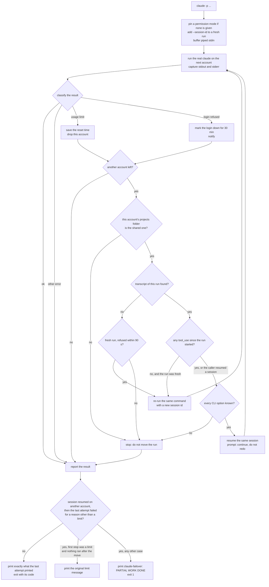
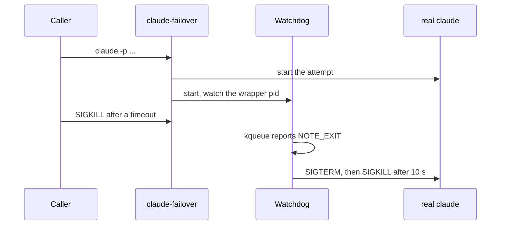
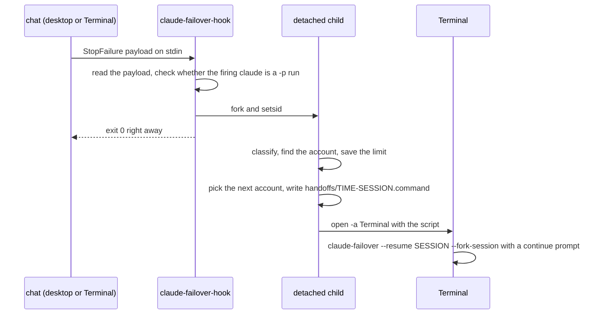

# Architecture

This is the engineering write-up: how the pieces fit, what each decision protects
against, and how it is tested. The [README](../README.md) covers setup and use.

Everything is Python 3.9 standard library, run by `/usr/bin/python3 -I` (isolated mode,
so no user packages or `PYTHON*` variables can change its behaviour).

- [The pieces](#the-pieces)
- [Account folders](#account-folders)
- [Routing a claude command](#routing-a-claude-command)
- [Headless failover](#headless-failover)
- [Limit detection](#limit-detection)
- [State and locking](#state-and-locking)
- [Exactly-once reasoning](#exactly-once-reasoning)
- [Permission-mode pinning](#permission-mode-pinning)
- [Signals and the watchdog](#signals-and-the-watchdog)
- [The StopFailure hook](#the-stopfailure-hook)
- [Login clock and spare token](#login-clock-and-spare-token)
- [Desktop chat sync](#desktop-chat-sync)
- [Testing](#testing)
- [Configuration](#configuration)

## The pieces

| Piece | Role |
|---|---|
| `bin/claude-failover` | Drop-in replacement for the `claude` binary. Same arguments, same output. |
| `bin/claude` | A tiny shim that runs `claude-failover`. Put `bin/` first on `PATH` and every plain `claude` started from your shell, scripts included, goes through the wrapper. launchd and cron jobs do not read `~/.zshrc`, so call `claude-failover` by its full path there. |
| `bin/claude-failover-hook` | A Claude Code `StopFailure` hook. Continues a chat on the next account when it hits a usage limit. |
| `bin/claude-accounts` | Setup and status: `init`, `add`, `login`, `status`, `hook`, `sync`, and more. |
| `bin/open-incognito` | The `BROWSER` for `claude-accounts login` when an account sets `login_browser` to `incognito`. Opens the login page in a private Chrome window. |
| `claude_failover.py` | The wrapper, the hook logic and `claude-accounts`. |
| `desktop_sync.py` | Copies desktop app chat records between account folders. |
| `tests/` | The unittest suite, a fake `claude` binary and a fake keychain tool. |

## Account folders

Claude Code keeps its settings, transcripts and account metadata in one config folder,
`~/.claude` by default. Claude Code's `CLAUDE_CONFIG_DIR` setting points it at another
folder. On macOS the login itself lives in the keychain, in an item whose name is derived
from that folder path (`Claude Code-credentials` for the default folder, the same name
plus a short hash of the path for any other). So one folder per account gives each
account its own login.

A separate folder would also split everything else: transcripts, memory, settings,
skills. So each account folder links the shared items back to `~/.claude`:

```
~/.claude/                        shared by every account (and by the desktop app)
├── projects/                     transcripts (<session id>.jsonl) and memory
├── settings.json  CLAUDE.md  keybindings.json  history.jsonl
├── skills/  agents/  commands/  hooks/  plugins/  output-styles/
└── file-history/  todos/  plans/  scheduled-tasks

~/.claude-work/                   one folder per account
├── .claude.json                  its own: which account is logged in, caches, user-scope MCP servers
├── projects -> ~/.claude/projects
├── settings.json -> ~/.claude/settings.json
└── ...                           every other shared item, as a symlink

keychain item: "Claude Code-credentials-<hash of $HOME/.claude-work>"
```

Because `projects/` is shared, any account can `--resume` any conversation, with its full
history and the same memory files. Only two things stay per account:

- **The login** - in the keychain. This code never reads it. Only `claude` does.
- **`.claude.json`** - holds `oauthAccount` (who is logged in), cached plan and feature
  data, and user-scope MCP servers. Sharing it would make every account look like the
  last one that wrote it. A new folder's `.claude.json` is seeded from `~/.claude.json`
  minus the account and cache keys, so onboarding, folder trust and preferences carry
  over.

Details that matter:

- **Exact paths** - the keychain item name depends on the exact folder string, so the
  wrapper always passes the same absolute, `~`-expanded path. Two spellings of one folder
  would be two different logins.
- **Never-empty shared folders** - Claude Code's cleanup removes empty folders under
  `~/.claude`. A removed `todos/` would leave a dangling link in every account folder, so
  each shared folder gets a `.keep` file.
- **Never replaces real files** - linking skips any item that already exists as a real
  file or folder. `claude-accounts add`, `setup` and `status` name items that are copies
  instead of links, and links that point at a missing folder. A copy splits memory. An
  unlinked `settings.json` means the account's chats never run the StopFailure hook, and
  an unlinked `projects` hides the account's transcripts from the wrapper, so its runs are
  not moved after a limit (see [Exactly-once reasoning](#exactly-once-reasoning)).
  `status --json` lists the items as `profile_problems`.
- **`securestorage_dir: ""`** - sets `CLAUDE_SECURESTORAGE_CONFIG_DIR` to an empty
  string. Claude Code reads this variable (it is not a documented setting) to choose the
  keychain item separately from the config folder. Empty means the default item, so an
  account can keep an existing plain `claude` login without logging in again, while still
  getting its own `.claude.json`.

## Routing a claude command

The wrapper parses the arguments the way Claude Code's option parser (commander) does,
then picks a route:

| Command | Route |
|---|---|
| Any command while the config has no accounts yet | Straight to the real claude with the caller's environment (minus this tool's own `CLAUDE_FAILOVER_*` variables), as plain `claude` would run it. `bin/` can be on `PATH` before the first `claude-accounts add`. A note goes to stderr only when it is a terminal. |
| `claude -p ...` | [Headless failover](#headless-failover). |
| `claude` (a chat) | Pick the first account in `order.interactive` that is not limited, then `exec` the real claude. The wrapper replaces itself, so the terminal talks to claude directly. |
| `claude --bare ...` | Straight through with the caller's environment. Bare mode ignores subscription logins and uses `ANTHROPIC_API_KEY`. |
| `claude mcp add`, `add-json`, `remove` (local or user scope), `claude purge` | Run once per account folder, plus once for the desktop app's `~/.claude.json`, because each `.claude.json` keeps its own MCP server list. Project scope (`.mcp.json` in the repo) runs once. |
| `claude --bg ...`, `agents`, `attach`, `logs`, `stop`, `kill`, `rm`, `respawn` | Background jobs live in the `jobs/` folder of the account that started them. The wrapper finds the folder that holds the job id, or the newest job when no id is given. |
| Other subcommands (`auth`, `update`, `doctor`, ...) | The `default_login_account`, unless `CLAUDE_FAILOVER_ACCOUNT` names another. |
| `--input-format stream-json` | The chat route. An SDK host keeps stdin open as a live stream, which cannot be replayed on another account. A caller that writes one message and closes stdin can set `CLAUDE_FAILOVER_ONESHOT_STDIN=1` to get headless failover. |

The environment handed to the real claude is built from the caller's, with three changes:

- **Login selectors removed** - `CLAUDE_CONFIG_DIR`, `ANTHROPIC_API_KEY`,
  `CLAUDE_CODE_OAUTH_TOKEN` and similar, so the account the wrapper picked is the one
  claude uses.
- **Host variables removed when nested** - a `claude -p` started by a desktop chat's Bash
  tool inherits that chat's `CLAUDECODE`, `CLAUDE_CODE_*` and `CLAUDE_AGENT_SDK_*`
  variables. A nested claude that sees them believes the desktop app is hosting it. They
  are dropped when the wrapper itself runs inside a Claude session.
- **Account markers added** - `CLAUDE_CONFIG_DIR` for the chosen account,
  `CLAUDE_FAILOVER_ACTIVE_ACCOUNT` (so the hook knows the account) and, for headless runs,
  `CLAUDE_FAILOVER_MANAGED=1` (so the hook leaves those runs to the wrapper).

## Headless failover

A `-p` run tries accounts in `order.headless`, skipping any account with a saved limit.
If every account is blocked it still tries them all, soonest reset first: a saved limit
can be stale, and a refused request costs a few seconds and no usage.



An account with a spare token saved gets a second attempt on that token when its login
is refused (see [Login clock and spare token](#login-clock-and-spare-token)). A usage
limit drops the token attempt too: same account, same limit.

## Limit detection

`classify(rc, stdout, stderr)` returns `ok`, `limit`, `auth` or `error`.

- **Exit code 0 is always `ok`.** A successful answer may quote a limit message freely.
- **JSON output** (`--output-format json` or `stream-json`). The `result` object decides:
  `api_error: "usage_limit_reached"` or a limit message in `result` means `limit`. The
  reset time comes from a `rate_limit_event` whose `rate_limit_info.status` is
  `rejected` (`resetsAt`, Unix seconds), or from `api_error_params.rate_limit_info`.
  A rejected `rate_limit_event` on its own also means `limit`.
- **Text output.** Only the first and last four non-empty lines of stdout and stderr are
  checked. A failed run prints just its error, so the edges are where it is.
- **Anchored patterns.** A limit line must start with one of the phrases Claude Code
  itself uses (`You've hit your ... limit`, `You're out of extra usage`,
  `Usage limit reached`, `5-hour limit reached`, `Your org is out of usage`, ...),
  optionally after `API Error:`, with straight or curly apostrophes. Anchoring keeps a
  server-side throttle (`Server is temporarily limiting requests (not your usage limit)`)
  from counting as a quota, and an extra check rejects that wording outright. Login
  failures (`Not logged in`, `OAuth token has expired`, `Please run /login`, ...) are
  matched the same way.
- **Reset times.** `resets 3:45pm (America/New_York)`, `resets Mon 12:00am` and
  `resets Nov 12 at 5pm` all parse, in the named time zone when there is one. A clock
  time that has already passed rolls to tomorrow, a weekday to its next date, a month and
  day far in the past to next year. Anything more than 8 days out is treated as a bad
  parse. With no usable reset time the account is re-tried after `unknown_reset_minutes`
  (30).
- **Model-scoped limits.** `You've hit your Opus limit` blocks only `opus` on that
  account. Messages such as `Switch to another model` or `requires usage credits` block
  only the run's own model family, taken from `--model` or the shared `settings.json`.
  Accounts are planned per model family, so an account out of one model still takes runs
  on another.

## State and locking

`state/accounts.json` holds what the wrapper has learned:

```json
{
  "accounts": {
    "work": {
      "limited_until": "2026-01-05T15:45:00-05:00",
      "limit_text": "You've hit your session limit · resets 3:45pm (America/New_York)",
      "limit_seen": "2026-01-05T11:04:52-05:00",
      "model_limits": {"opus": "2026-01-12T00:00:00-05:00"},
      "last_ok": "2026-01-05T11:02:17-05:00",
      "logged_in_at": "2026-01-01T09:30:00-05:00",
      "login_expires_at": "2026-01-31T09:30:00-05:00"
    }
  },
  "handoffs": {
    "3f1c...": {"at": "2026-01-05T11:05:00-05:00", "until": "2026-01-05T15:45:00-05:00", "to": "personal"}
  }
}
```

- **Locking** - scheduled jobs run in parallel, so every read-modify-write holds an
  exclusive `fcntl.flock` on `state/.lock`.
- **Atomic writes** - the new file is written to a temp file in the same folder and moved
  into place with `os.replace`. A crash never leaves half a JSON file.
- **Event log** - `state/events.jsonl` gets one JSON line per headless attempt (`run`),
  failover, hook event and handoff (`failover`, `handoff`, `hook_limit`, `hook_ignored`,
  ...), and one per desktop sync that changed something. Which account a chat starts on is
  not logged. `claude-accounts log` prints the tail.
- **A success does not clear a saved limit.** Past its limit, an account with paid extra
  usage turned on still answers, and bills for it. A limit therefore lasts until its reset
  time. A wrong record cannot stall work, because blocked accounts are still tried when
  nothing else is usable.
- **Bookkeeping never changes the result.** If saving state fails, the run's output and
  exit code are passed through unchanged.

## Exactly-once reasoning

Moving a task to another account is only useful if it never does the same thing twice.
Each rule below closes one way that could happen.

- **Re-run only when no tool ran.** Apart from hooks you configured yourself
  (SessionStart, UserPromptSubmit and the like), which fire again on a re-run, a tool call
  is the only way a run changes anything: shell commands, file edits, sent messages, MCP
  calls. If the transcript holds no
  `tool_use` block, the stopped attempt produced only text, so running the whole prompt
  again elsewhere is safe. If any tool ran, the wrapper resumes the same session instead,
  with a prompt that says which account stopped and why, and asks the model to continue
  from the tool results above without repeating any finished action.
- **Why `--session-id` is injected.** Checking for tool calls needs the transcript of
  this exact run, and Claude Code names transcripts after the session id. When the caller
  picks none, claude picks a random one the wrapper cannot reliably learn (parallel runs,
  plain text output). So every fresh run gets a UUID through `--session-id`. The same
  goes for `--resume X --fork-session`, whose fork would otherwise get a random id.
- **Resumed sessions count from now.** When the caller itself passes `--resume <id>`, the
  transcript already holds older turns and their tool calls. Only tool calls stamped after
  this run started count.
- **When it cannot tell, it does not move.** `--no-session-persistence` writes no
  transcript, and `-c`/`--continue` picks a session the wrapper cannot name in advance.
  An account folder that kept its own `projects` folder (one used with `CLAUDE_CONFIG_DIR`
  before) writes its transcripts where the wrapper does not look, so its runs never move.
  With no transcript in the shared projects folder, a fresh run refused within
  `turned_away_seconds` (90) is treated as turned away before it started and is re-run.
  This holds only because the account's `projects` is the shared one. Anything else stops
  and returns Claude's original message (the limit or the login error), which callers
  already handle.
- **Unknown CLI options block a resume.** The resume command is rebuilt from the caller's
  arguments: drop the prompt and the session flags, keep the rest, add `--resume <id>` and
  the continuation prompt. Finding the prompt means knowing which options take a value
  (`--model opus` against `--verbose`). For an option the wrapper does not know, it cannot
  tell whether the next word is that option's value or the prompt, and a wrong guess could
  drop a value or resume with the wrong text. So it stops instead. `claude-accounts argspec`
  rebuilds the option table from the installed CLI after an update. A re-run passes the
  arguments through untouched, so unknown options are fine there.
- **Piped stdin is read once.** A re-run replays it. A resume sends empty stdin, because
  the first turn's input is already in the transcript.
- **The partial-work marker.** Say account A did part of a task, hit its limit, and the
  wrapper resumed on account B, which then failed for an unrelated reason such as an
  expired login. Passing B's error through would mislead the caller: scripts often read a
  login error as "nothing happened, retry later", and the retry would redo A's part. So if
  B did nothing, the caller sees A's original limit message, which is accurate. Otherwise
  it sees a line starting `claude-failover: PARTIAL WORK DONE` that names both accounts and
  asks for a check before running the task again, with exit code 1. The same goes when B's
  claude is killed by a signal the caller did not send (a crash, or macOS under memory
  pressure): its 128-plus-signal exit code would invite the same retry. Only a stop signal
  from the caller itself ends the run with 128 plus the signal number.

## Permission-mode pinning

A `-p` run that passes neither `--permission-mode` nor `--dangerously-skip-permissions`
gets `--permission-mode default`, or the `permissions.defaultMode` named in its own
`--settings` JSON.

The reason: `settings.json` is shared with your interactive chats. If you set
`permissions.defaultMode` to `bypassPermissions` there for your own chats, every headless
script would inherit bypass mode, and in bypass mode `--allowedTools` no longer limits
anything. Pinning keeps scripts default-deny whatever the settings file says. Interactive
runs are not touched.

## Signals and the watchdog

Headless runs keep the real claude as a child process, so the wrapper owns its lifetime.

- **Forwarding** - SIGTERM, SIGINT and SIGHUP are passed on to claude. After a stop signal
  the wrapper starts no further attempt and exits with 128 plus the signal number, as a
  shell would.
- **The watchdog** - SIGKILL cannot be caught. A caller that times out and kills the
  wrapper (Python's `subprocess.run(timeout=...)` kills only the process it started)
  would leave claude running as an orphan, still working and still using quota. So each
  attempt starts a small watchdog in its own session. It registers the wrapper's pid with
  kqueue (`EVFILT_PROC` with `NOTE_EXIT`) and blocks until the wrapper exits. If claude's
  parent is then pid 1 (orphaned), it sends SIGTERM, waits up to 10 seconds, then SIGKILL.
  When an attempt ends normally the wrapper stops the watchdog first.



## The StopFailure hook

Claude Code runs `StopFailure` hooks when a turn ends because of an API error.
`claude-accounts hook install` registers `bin/claude-failover-hook` in the shared
`~/.claude/settings.json` with the matcher `rate_limit`, so it fires for every account and
for desktop app chats.



Step by step:

1. **Detect a print run before forking.** A `claude -p` started from a desktop chat's
   Bash tool inherits the desktop app's variables (its entrypoint and account id) but runs
   on its own login. The wrapper handles those runs, so the hook must only record them.
   It reads the exact argv of the firing process (the one named by `CLAUDE_PID`, then
   the hook's own parent, each with up to two of its ancestors) through the macOS
   `sysctl` `KERN_PROCARGS2` call. `ps` joins arguments with spaces, so a prompt
   containing ` -p ` would look like the flag. The sysctl returns each argument
   separately. This has to happen before the fork, because after `setsid` the hook's
   parent is launchd.
2. **Fork and detach.** The parent exits 0 at once, so Claude never waits on the hook and
   a session that is shutting down cannot cut the handoff off halfway.
3. **Classify.** Only usage limits act. Other errors are logged and ignored, and a
   subagent's failure is left to its main turn.
4. **Find the account.** `CLAUDE_FAILOVER_ACTIVE_ACCOUNT` when the wrapper started the
   session, else the desktop app's account id or email matched against the config, else
   `CLAUDE_CONFIG_DIR`, else the default login. Desktop variables are ignored for print
   runs.
5. **Record the limit**, so the wrapper avoids that account as well. Headless sessions
   stop here, and so do chats whose kind is turned off in `handoff.from_desktop` or
   `handoff.from_terminal`.
6. **Model-only limits stay put.** If only the chat's model ran out and another model
   still works on the same account, the chat is not moved. A notification suggests
   switching the model.
7. **One handoff per chat per limit window.** A ledger maps each session id to
   `{at, until, to}`. `until` is the reset time Claude stated, or 6 hours when it stated
   none. Typing in the stuck chat again only brings a notification that it already
   continued in Terminal. The ledger keeps the newest 200 entries.
8. **Pick the target.** The first account in `order.interactive` that has usage for this
   model. If every other account is out of it, the first one where a model from
   `handoff_model_fallbacks` (default opus, then sonnet) still works, with `--model` set.
9. **Write and open the script.** `handoffs/<time>-<session>.command` changes to the
   chat's folder and runs
   `CLAUDE_FAILOVER_ACCOUNT=<next> claude-failover --resume <session> --fork-session ...`
   with the chat's permission mode and a prompt that explains the move and says
   desktop-only tools are not available in Terminal. `open -a Terminal` runs it, and a
   macOS notification says where the chat went.
10. **Sync the desktop chat list.** When desktop sync is enabled, the hook runs one sync
    right away, so the chat is already listed under the next account when you switch the
    desktop app to it.

`--fork-session` gives the continuation its own session id, so the original transcript
is never written by two processes at once. Claude Code can also restart a stopped chat by
itself when its limit resets (the `autoContinueAtUsageLimit` setting). With a handoff
that would run the same work in two places, so `hook install` sets it to `false`. Both
`hook install` and `hook uninstall` save a dated copy of `settings.json` in the state
folder before they change it.

The hook command is this copy's full path. After the repo folder moves, `hook status`
says the command is MISSING, and `hook install` points the entry at the new place. Both
also name any account folder with its own `settings.json` instead of the link, since
chats on that account never run the hook.

## Login clock and spare token

A CLI login does not last forever, and Claude Code only warns about the end inside an
interactive chat, which headless jobs never are. `claude auth status` keeps saying
"logged in" until a request is refused.

- **The clock** - `claude-accounts login` records the date. Newer CLI versions also report
  when the login ends (`loginExpiresAt` in `claude auth status`, `credential_expires_at`
  in `-p` JSON results). The wrapper keeps the latest date it sees. The CLI says the real
  end can come up to 3 days earlier, so `status` asks for a re-login from 5 days before
  that earliest day. Without a date from the CLI it falls back to an observed lifetime of
  about 30 days and asks from day 25.
- **The spare token** (optional) - `claude-accounts token <account>` runs
  `claude setup-token`, Anthropic's one-year token for environments without a browser.
  You paste the token into a hidden `security add-generic-password` prompt, so it goes
  straight into the keychain (item `claude-failover-spare-token`) and never touches a
  file. A test call runs on it right away.
- **When the token is used** - when a headless run's login is refused, and for the test
  call of `claude-accounts token` and `claude-accounts test`. The same account is retried
  with the token in the child's environment, and the token is replaced
  by `[spare token]` in anything that comes back. While the login is known to be down,
  runs go straight to the token and the login is re-tried every
  `auth_down_recheck_minutes`.
- **Why it stays a spare** - with a token, `claude auth status` cannot say which account
  it belongs to, so the wrong-account check goes blind, and token mode cannot use claude.ai
  connectors or Remote Control. Everyday runs keep the login, where every check works.
- **Without a token** the wrapper never calls the keychain tool at all.

## Desktop chat sync

The desktop app stores its list of Code chats per account, while the conversations
themselves sit in the shared `~/.claude/projects`. So signing the app into another
account shows an empty sidebar. `claude-accounts sync` copies each chat's small JSON
record into every account's folder: the union of all chats, the freshest copy winning,
account-bound fields (connectors, Remote Control) stripped, deletions carried over as
tombstones, and only additions in the folder the running app is using. A LaunchAgent can
run it every few minutes. Full details: [DESKTOP-SYNC.md](DESKTOP-SYNC.md).

## Testing

The suite is plain `unittest`, needs no network and no Claude account, and never touches
the real keychain, `~/.claude` or `~/Library`.

- **A fake `claude`** - `tests/fake_claude.py` stands in for the real binary. A JSON plan
  gives each account a behaviour per call (`ok`, `limit`, `weekly_limit`, `opus_limit`,
  `work_then_limit`, `auth`, `auth_unless_token`, `throttle`, `sleep`, ...). It writes
  transcripts with or without `tool_use` blocks, prints text or JSON results like the
  real CLI, and logs every call (argv, stdin, environment keys, config folder) so tests
  can assert exactly what ran where.
- **A fake keychain** - `tests/fake_security.py` mimics `security find-generic-password`
  from a JSON file. The config's `security` key points the code at it.
- **Real entry points** - tests run `bin/claude-failover` and `bin/claude-failover-hook`
  as subprocesses, with a temp config, temp state and handoff folders, and
  `CLAUDE_FAILOVER_NO_NOTIFY=1`.
- **Hard cases covered** - work done before a limit (resume, never re-run), a second
  account failing after partial work (marker), unknown options, fork sessions, signal
  forwarding, a SIGKILLed wrapper (the watchdog kills the orphan), print-run detection
  from `CLAUDE_PID`, one handoff per limit window, the spare token never appearing in
  output, and desktop sync against a temp folder shaped like the app's.

Run it with:

```bash
/usr/bin/python3 -m unittest discover -s tests -v
```

CI runs the same command on macOS for every push and pull request.

## Configuration

`claude-accounts init` writes a starter config to `$CLAUDE_FAILOVER_CONFIG` when it is
set, else to `~/.config/claude-failover/config.json`. When `$CLAUDE_FAILOVER_CONFIG` is
set, the tool uses only that file, and a missing file means no config. Otherwise it uses
`config.json` in the repo folder when there is one, else
`~/.config/claude-failover/config.json`. The repo file is gitignored, so only an install
that keeps its config there (the original layout) has one, and `claude-accounts init` in
another clone can never take that install over. `init --force` starts over in the config
that is in use, after a dated backup. Paths may start with `~`. [`config.example.json`](../config.example.json) shows the usual keys, and
this table lists all of them.

| Key | Default | Meaning |
|---|---|---|
| `real_claude` | detected on every run | Path of the real Claude Code binary. Leave it out (`init` does) and it is looked up on every run: `$CLAUDE_FAILOVER_REAL_CLAUDE`, `~/.local/bin/claude`, `~/.claude/local/claude`, `/opt/homebrew/bin/claude`, `/usr/local/bin/claude`, then `PATH`. So a Claude Code that moves is still found. A configured path is used as it is. Anything inside this repo's `bin/`, or another copy of claude-failover, is refused, since it would run the wrapper again. |
| `default_config_dir` | `~/.claude` | The folder every account shares, and the one the desktop app uses. |
| `projects_dir` | `projects/` in `default_config_dir` | Where the shared transcripts are. |
| `state_dir` | `state/` next to the config | Saved limits, login dates, `events.jsonl`. Also `$CLAUDE_FAILOVER_STATE_DIR`. |
| `handoff_dir` | `handoffs/` next to the config | Scripts the hook writes. Also `$CLAUDE_FAILOVER_HANDOFF_DIR`. |
| `accounts[].name` | | Short name used in commands and in `order`. |
| `accounts[].email` | | The claude.ai email. `status` says WRONG ACCOUNT if the folder holds another login. |
| `accounts[].config_dir` | none: the plain `~/.claude` login | The account's `CLAUDE_CONFIG_DIR`. `claude-accounts add` sets `~/.claude-<name>`. |
| `accounts[].desktop_account_uuid`, `desktop_org_uuid` | `null`: read from the account's own `.claude.json` | Which desktop app chat folder belongs to the account. An account without its own folder needs `desktop_account_uuid`, since the shared `~/.claude.json` can name another account. |
| `accounts[].securestorage_dir` | `null`: unset | `""` reuses the plain `Claude Code-credentials` login for this account. |
| `accounts[].login_browser` | default browser | `"incognito"` opens the login page in a private Chrome window, for an account your normal browser is not signed in to. |
| `order.interactive` | config order | Account order for chats and handoffs. |
| `order.headless` | config order | Account order for `-p` runs. |
| `default_login_account` | the account on the plain `Claude Code-credentials` login (no `config_dir`, or `securestorage_dir` set to `""`), else the first | Account for subcommands such as `claude auth` and `claude update`. |
| `handoff.from_desktop`, `handoff.from_terminal` | `true` | Which chats the hook continues in Terminal. |
| `handoff_model_fallbacks` | `["opus", "sonnet"]` | Models to try when the next account is out of the chat's model. |
| `unknown_reset_minutes` | `30` | How long a limit with no stated reset time lasts. |
| `auth_down_recheck_minutes` | `30` | How long to skip an account whose login was refused. |
| `turned_away_seconds` | `90` | A fresh run refused this fast, with no transcript, counts as nothing having run. |
| `desktop_sync.enabled`, `desktop_sync.interval_minutes` | `false`, `10` | `enabled` (set by `sync install`) makes the hook sync after a handoff and `status` show a desktop chats line. `interval_minutes` is the interval `sync install` uses when you give no `--every`. The LaunchAgent keeps the interval it was installed with, so run `sync install` again after changing it. |
| `desktop_sync.app_data_dir` | `~/Library/Application Support/Claude` | The desktop app's data folder. Also `$CLAUDE_FAILOVER_DESKTOP_DIR`. |
| `security` | `/usr/bin/security` | The keychain tool used for spare tokens. Tests point it at a fake. |

**Tip** - if your desktop app stays signed in to one account, put that account last in
`order.headless`. Scripts then use the other account first and leave the desktop
account's usage for your chats.

Environment variables:

| Variable | Effect |
|---|---|
| `CLAUDE_FAILOVER_ACCOUNT=<name>` | Use this account only, for this one call. |
| `CLAUDE_FAILOVER=off` | Run the first set-up account in `order.interactive` (or the `CLAUDE_FAILOVER_ACCOUNT` one) directly, with no failover. This applies to `-p` runs too. |
| `CLAUDE_FAILOVER_VERBOSE=1` | Print failover notes on stderr for `-p` runs. |
| `CLAUDE_FAILOVER_CONFIG`, `CLAUDE_FAILOVER_STATE_DIR`, `CLAUDE_FAILOVER_HANDOFF_DIR` | Override file locations. |
| `CLAUDE_FAILOVER_REAL_CLAUDE` | Where to look first for the real claude when the config has no `real_claude`. |
| `CLAUDE_FAILOVER_ONESHOT_STDIN=1` | Treat a stream-json caller that sends one message as a headless run. |
| `CLAUDE_FAILOVER_NO_NOTIFY=1` | No macOS notifications. |
| `CLAUDE_FAILOVER_HOOK_FOREGROUND=1` | Run the hook without detaching (used by tests). |
| `CLAUDE_FAILOVER_DESKTOP_DIR`, `CLAUDE_FAILOVER_LAUNCH_AGENTS_DIR` | Use another desktop app data folder or LaunchAgents folder (tests use temp folders). |
| `CLAUDE_FAILOVER_LAUNCHCTL` | The `launchctl` that `sync install` and `sync uninstall` call, or `0` to call none (used by tests). |
| `CLAUDE_FAILOVER_APP_RUNNING=1` or `0` | Tell desktop sync whether the app is running instead of asking `ps` (used by tests). |
