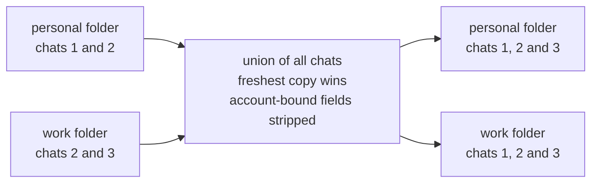

# Desktop chat sync

The Claude desktop app keeps its list of Code chats per account. Sign the app into
another account and the sidebar is empty, even though every conversation is still on
disk. `claude-accounts sync` copies each chat's record into every account's folder, so
every account lists every chat, with its full history. The same run copies the signed-in
account's [scheduled tasks](#scheduled-tasks) and [task backlog](#the-task-backlog) into
the other accounts, and `claude-accounts sync handover` lists the chats that a switch left
[in the middle of their work](#picking-up-after-a-switch).

This page covers what the app stores where, how sync decides what to copy, what it
leaves alone, and how to undo it. The rest of the design is in
[ARCHITECTURE.md](ARCHITECTURE.md).

## Where the desktop app keeps chats

```
~/Library/Application Support/Claude/
├── config.json                        lastKnownAccountUuid = the signed-in account
└── claude-code-sessions/
    └── <accountUuid>/
        └── <orgUuid>/
            ├── local_<id>.json        one record per chat
            ├── deleted_<id>           tombstone of a deleted chat
            ├── archived-sessions.idx  load-order hint
            ├── scheduled-tasks.json   desktop scheduled tasks
            ├── backlog/tasks.json     the task backlog (task cards set aside for later)
            └── waiting-input/

~/.claude/projects/<folder named after the cwd>/<cliSessionId>.jsonl
                                       the conversation itself, shared by every account
```

Each chat is two files:

- **The record** - `local_<id>.json`, stored per account. One JSON object with
  `sessionId` (`local_<id>`), `cliSessionId`, `cwd`, `title`, `model`,
  `permissionMode`, `isArchived`, times in milliseconds (`createdAt`,
  `lastActivityAt`, `lastTurnEdgeAt`, `latestUserFrameAt`, `lastFocusedAt`) and many
  UI fields.
- **The conversation** - the Claude Code transcript `<cliSessionId>.jsonl` in the shared
  `~/.claude/projects` (see [account folders](ARCHITECTURE.md#account-folders)).

How the app treats these files. This was learned by reading the app's files and bundle
(Claude desktop 4.23118.1). It is not a documented interface.

- It reads the folder only at launch and when you switch accounts. There is no file
  watcher.
- While it runs, it keeps the signed-in account's records in memory and rewrites them.
  It never deletes files it does not know.
- Deleting a chat writes a tombstone `deleted_<id>` (its content is the time in
  milliseconds) and removes the transcript.
- `archived-sessions.idx` is only a load-order hint. `isArchived` inside the record is
  what counts.
- An account folder can hold more than one organization folder, because the app creates
  near-empty ones. The one with the `local_*.json` files is the real one. A CLI account
  folder's `.claude.json` has `oauthAccount.accountUuid` and
  `oauthAccount.organizationUuid`, which match these folder names.
- It skips session files over 10 MiB and refuses files with more than one hard link.

## Why chats vanish when you switch accounts

The record sits under the account's id, while the transcript sits in the shared projects
folder. When the app switches to another account it reads that account's folder, finds
no record for the chat, and leaves it out of the sidebar. Nothing is lost. Put a copy of
the record into the other account's folder and the chat shows up there with its full
history, because the transcript it points to is the same file.

## How sync works



Each run:

1. **Find the folders.** For every configured account, the chat folder named by its
   account and organization ids. They come from the config (`desktop_account_uuid`,
   `desktop_org_uuid`), else from the account's own `.claude.json`. If the organization
   is still unknown, the organization folder with the most chats is used. An account
   that uses the plain `~/.claude` login has no `.claude.json` of its own (the shared
   `~/.claude.json` can name another account), so it needs `desktop_account_uuid` in the
   config. The ids are the folder names under `claude-code-sessions` (letter case does not
   matter: sync uses the spelling on disk), and `claude-accounts sync --dry-run` names every
   account it could not match.
2. **Read what it understands.** Every `local_*.json` record and `deleted_*` tombstone.
   Anything that is not valid JSON, lacks the expected fields or is over 10 MiB is
   skipped and left untouched. A copy that would come out over 10 MiB (the target keeps
   its own account fields, so a copy can grow) is not written, and the run reports an
   error: the app would skip that file.
3. **Union.** A chat that exists in any account's folder should exist in all of them.
4. **Freshness.** When copies of one chat differ, the copy with the latest activity time
   wins. A rename, an archive or a model change leaves the activity time as it was, so
   when those are equal the copy whose content changed last wins. File times alone would
   mislead here: the app rewrites a record (its `lastFocusedAt`) whenever you open the
   chat, so an old copy you only looked at would look newest. Sync keeps a hash of each
   record's content without `lastFocusedAt` or the fields each folder keeps for itself
   (step 5), and when it last changed, in `seen.json` in its state folder. While a
   record's content is unchanged, that remembered time stands.
   The first sync, with no `seen.json` yet, goes by file times.
5. **Strip account-bound fields.** claude.ai connectors and Remote Control belong to one
   account, so these fields are removed before a record is written into another account:
   `bridgeSessionIds`, `remoteMcpServersConfig`, `mcpConnectorsAsked`,
   `mcpConnectorsAskedOut`, `mcpToolsAskedOff`, and the `enabledMcpTools` entries keyed
   `<connectorUuid>:<tool>`. Entries starting with `local:` are machine-local and stay.
   When the app loads a record without these fields it uses the account's own. When sync
   updates a chat that the other account already lists, that account's own values for
   these fields are kept. The markers the app sets when it quits during a turn never
   travel at all (see [What is not synced](#what-is-not-synced)).
6. **Only additions in the running app's folder.** While the app runs it holds the
   signed-in account's records in memory and writes them back, so a change made under it
   would be overwritten or would fight with its state. Sync therefore only adds missing
   chats to that one folder. The app shows them after a restart, since it reads the
   folder at launch. Every other folder, and every folder while the app is closed, gets
   full updates.
7. **Deletions travel.** A deleted chat stays deleted: sync copies its tombstone to the
   other folders and moves their copies of the record to the trash, so the union can
   never bring it back. Like any other change, this waits for the running app's own
   folder until the app is closed.
8. **Old copies are kept for a while.** The first run that changes anything saves a
   backup tarball of the records and tombstones of every account in the config at that
   time. Any record sync replaces or removes is moved to a trash folder, which keeps the
   two newest copies of each file for up to 30 days and deletes older ones. New files are
   written to a temp name and renamed into place, as plain files with a single link.

Chat sync never edits `archived-sessions.idx`, `waiting-input/` or any other file that is
not a `local_*.json` record or a `deleted_*` tombstone. The only other files a run writes
are the `scheduled-tasks.json` and the `backlog/tasks.json` of accounts the app is not
signed in to, by the rules in the next two sections.

## Scheduled tasks

The desktop app keeps scheduled tasks per account too, in `scheduled-tasks.json` next to
the chat records, and it runs only the tasks of the account it is signed in to. A task
made under one account would be missing after a switch. So every sync also copies the
signed-in account's task list into the other accounts' files.

How the app treats the file. This was read from the app's bundle (Claude desktop
6.28899.6). It is not a documented interface.

- It reads the file once, when the app signs in to that account. It keeps the tasks in
  memory and rewrites the whole file from memory after every change. There is no file
  watcher.
- A task is repeating (`cronExpression`), one-time (`fireAt`, a time in milliseconds) or
  run by hand (neither). `lastRunAt` and `lastScheduledFor` say which run happened last.
- When it loads a list, a repeating task that is on runs once for the latest slot it
  missed in the last 7 days. A one-time task that is on, has no `lastRunAt` and whose
  time has passed runs at once.
- A task's prompt is a file in the shared `~/.claude/scheduled-tasks/<id>/`, so every
  account already has it. Only the list is per account.

The rules. All of them are in `desktop_tasks.py`.

1. **The signed-in account's list is the source.** Sync finds that account from
   `lastKnownAccountUuid` and only reads its file, because the app would write its own
   copy back over a change. This holds while the app is closed too.
2. **Same id: replaced.** A task the other account already has is replaced by an exact
   copy, run times included. That is what stops a switch from replaying runs that
   already happened.
3. **Missing: added.** Every repeating task and every run-by-hand task the other account
   lacks is added. A one-time task is added only while it is on and its time is still
   ahead, and not while a twin of it (rule 4) is still on there. Finished ones are
   history.
4. **A one-time task that ran is marked as run on the other account** (off, with
   `lastRunAt`), so it cannot fire a second time after a switch. This also covers a copy
   someone made by hand under another id: a one-time entry with the same name and the
   same time.
5. **Nothing is deleted.** A task only the other account has stays there and sync
   reports it. If it is still on, `sync status` says the lists differ.

How it stays safe:

- Only files of accounts the app is not signed in to are written, through a temp file and
  a rename, with the permission bits the file had.
- Before a list is replaced, a copy of it goes to
  `desktop-sync/task-backups/<account id>/<organization id>/` in the state folder: the
  first time each day, and again whenever the file is not the one sync wrote last (the
  app or you changed it since). Copies older than 30 days are removed. The 5 newest
  always stay.
- A file sync is not sure about (not JSON, an entry without an id, a link, a second hard
  link) is left alone, and sync says so. If the signed-in account's list is such a file,
  nothing is copied.
- If sync cannot tell which account the app is signed in to, or the config has two
  folders for that account, nothing is copied.
- The app's config names the signed-in account, not its organization. So when an account
  has tasks in more than one organization folder and the config does not name the one to
  use (`desktop_org_uuid`), sync leaves that account's lists alone and says so. Empty
  lists do not count: the app leaves those behind when it switches accounts.
- Everything else in the other account's file (`recordedSkips` and whatever else the app
  keeps there) is left as it is.

`claude-accounts sync --dry-run` prints each planned change. `claude-accounts sync status`
says whether the lists match right now. `"desktop_sync": {"scheduled_tasks": false}` in
the config turns the copying off: sync then only lists the tasks that would not run under
the signed-in account, as a heads-up.

## The task backlog

When a chat proposes a task for later and you set its card aside, the app files the task
in a backlog, `backlog/tasks.json`, again one list per account. So every sync also copies
the signed-in account's backlog into the other accounts' files.

How the app treats the file (read from the app's bundle, Claude desktop 6.28899.6, not a
documented interface): it reads the list when it is first needed after a sign-in, keeps
it in memory and writes the whole file back after every change. An item is a card with a
title, a prompt and the chat it came from. Two entries are the same item when they name
the same chat and the same proposal in it. An item is dropped 30 days after it was
proposed.

The rules. All of them are in `desktop_backlog.py`.

1. **The signed-in account's list is the source** and is only read.
2. **Missing: added, while there is room.** An item the other account lacks is added,
   unless it is older than 30 days. The app keeps 20 items per folder and 100 in all, and
   at a save it drops the oldest beyond that. So sync fills a folder only to 17 and a list
   only to 90: the newest items get that room, the rest are reported as not copied, and
   the places left free are for the items the app files there itself. Otherwise the app
   would make room by dropping that account's own items.
3. **Started or dropped: removed.** Sync remembers which items each account's list held.
   An item the signed-in account held and no longer has was started or dropped there, so
   it is removed from the other account's list too. Otherwise it would come back after a
   switch and invite doing the work twice. Two things that look the same are not that:
   - **An item the app never took over.** What sync wrote into a list counts as held
     there in two cases: the app's own save kept another item of the same or a later
     write, or the app was still signed in to another account after the write was made.
     The app reads an account's list when it signs in to it, so its next sign-in there
     finds the write. A look at the signed-in account's own list settles nothing, however
     long the file sits there untouched: the app may have opened the list a moment before
     the write. In every other case the app may have saved an older copy of the list over
     the write, and the item stays on the account it came from. This is a rule of thumb
     about an app that documents none of this, not proof. It errs on the side of keeping:
     an item kept by mistake comes back once after a switch, while an item removed by
     mistake would be gone from both accounts (a copy stays in the backups).
   - **An item pushed out of a full folder.** While a folder holds 20 items, or the list
     100, the app drops the oldest by itself. An item that left such a folder is not
     taken off the other list.

   Nothing is removed on the first sync, and nothing when the signed-in account has no
   backlog file at all.
4. **Only on the other account: kept.** An item the signed-in account never had stays.
   It reaches the signed-in account's list at the next switch, when the other account
   becomes the source.

It is as careful as the task sync: only files of accounts the app is not signed in to are
written, through a temp file and a rename; a copy of the list goes to
`desktop-sync/task-backups/<account id>/<organization id>/backlog.<date>-<time>.json`
first; a file it is not sure about (not JSON, a newer format, a link) is left alone.
`"desktop_sync": {"backlog": false}` in the config turns it off.

## Picking up after a switch

Signing the app out kills every chat that is in the middle of a turn. The app writes no
mark on those chats (it only does when it quits), and nothing continues them. The same
goes for a crash or a restart of the Mac, and a turn can also end early at a usage limit.
`claude-accounts sync handover` finds these chats:

```
Chats to pick up (active in the last 48 hours)
  cut off mid-turn - the app was signed out or quit; they do not go on by themselves
    Fix the import script - cut off mid-turn at 1:03 AM (last step: Bash - Run the tests)
      local_11111111-2222-4333-8444-555555555555
  waiting for you
    Name the release - waits for you since 12:24 AM: v2 or v2.0?
      local_66666666-7777-4888-8999-aaaaaaaaaaaa
```

How it decides. The rules are in `desktop_handover.py`.

- **The end of the transcript.** A finished turn ends with a reply whose `stop_reason` is
  `end_turn`. A transcript that ends with a tool call, a tool result or a prompt has no
  such reply: the turn was cut off. A last message that is an error (a usage limit, a
  lapsed login) is a turn that failed. A turn you stopped yourself is neither. A message
  from another chat and a skill's text count as prompts. The filler reply the CLI writes
  before such a message ("No response requested.") is not a reply, so a chat that was
  restarted and died before its first answer is still cut off.
- **The process list.** While a chat works, its transcript also ends in the middle of a
  turn. The difference is its `claude` process, which names the chat (`--resume=<id>`).
  A brand-new chat's process names none, so it is matched by its start time. A chat
  with a process is working and is not listed. If `ps` cannot be asked, no chat is
  called cut off. After a passing error (the Mac slept, the connection dropped) Claude
  Code tries again by itself, so a chat with a process is not called stopped until the
  error is 5 minutes old. A usage limit or a lapsed login is listed at once.
- **The chat record.** After a turn the app notes on the record whether the chat needs
  something from you. Those chats are listed as waiting.

Only chats with a record in an account folder are looked at, archived ones are left out
(when the accounts' copies disagree, the file that changed last decides), and the command
only reads. `--hours N` changes how far back it looks, and `--json` prints
the list with each chat's id for a chat that picks the work up. `claude-accounts sync
status` says how many chats there are, and `desktop_sync.handover_lines(cfg)` gives the
list as text lines to other code.

To go on with a chat, open it and say "continue". A turn that was cut off in the middle
of a step may have finished that step or not, so the chat should check before it repeats
anything. The app can also send that message by itself after a switch: see the next
section.

## Restarting cut-off chats by themselves

Off unless you turn it on:

```bash
claude-accounts sync auto-restart on     # and: off, or no argument to see where it stands
```

With it on, the chats that a sign-out cut off start again by themselves once the app is
signed in to the other account: the newest 3, and only when that account has a current
usage reading with usage left. The readings come from `account_switch.py`
(`claude-accounts usage`; its watcher, `claude-accounts watch install`, keeps them
current, see [SWITCHING.md](SWITCHING.md)). Without a reading nothing is armed and
nothing is restarted, and `claude-accounts sync auto-restart` says so.

Nothing outside the app can type into a chat, so the restart comes from inside it,
through the app's own scheduled tasks:

1. **A pick-up task waits in the other account's task list.** Every sync makes sure the
   task list of each account the app is not signed in to holds a one-time task named
   "Pick up after an account switch" whose time has already come. The app starts such a
   task the moment it reads the list, which is when it signs in to that account. This is
   the one task that is not copied as it is ([scheduled tasks](#scheduled-tasks) rule 2):
   after it ran on one account, the copy on the other account is armed again.
2. **The task claims the chats.** Its instructions are one file,
   `~/.claude/scheduled-tasks/pick-up-after-account-switch/SKILL.md`. It runs
   `claude-accounts sync restart --json`, which lists the chats to restart and marks each
   one as taken (`desktop-sync/restarts.json` in the state folder).
3. **Each claimed chat gets one message**, about a minute apart: it was cut off by the
   switch, it should first check what already happened so that nothing is done or sent
   twice, and then carry on. The chat continues under its own settings, in the app, as
   the same chat.

What `sync restart` hands out, and what it never does:

- **Only a chat that was cut off in the middle of a turn** in the last 6 hours, with no
  process left ([the same test as the list above](#picking-up-after-a-switch)). The time
  of the cut counts, not the time the file last changed. It looks twice, 5 seconds apart,
  and leaves a chat alone that moved in between.
- **A few at a time.** One run hands out the newest 3 (`"desktop_sync": {"restart_max":
  N}` changes that). Every restarted chat is a heavy turn on the new account, and a dozen
  at once is how a week of usage, or the Mac's memory, is used up. The others are listed
  with the reason and wait for you.
- **Never a chat twice.** A claim stands for 15 minutes or until the chat moves on, so a
  second run, or another helper that reads `sync handover`, sees "restart sent". A claim
  made while the app was signed in to another account does not hold: that run died with
  the sign-out.
- **Nothing when auto-restart is off.** A pick-up task that starts anyway (it was still
  armed, or someone pressed Run now) gets an empty list. `sync restart --by-hand` is for a
  person or a chat that wants the list while auto-restart is off. It is not a way around
  the next two checks: it still needs the gate's yes and a usage reading.
- **Nothing when the gate says no.** `"desktop_sync": {"restart_gate": "<command>"}` names
  a command that is run before any chat is handed out. Any exit code but 0 means not now,
  for example a check that enough memory is free.
- **Never a chat that was continued elsewhere**: one the StopFailure hook handed to
  Terminal since it stopped (a `handoff` event in the event log), or one that has a fork.
- **Never a turn that ended at a usage limit.** That is the hook's case, and the chat is
  listed as stopped, not cut off.
- **Never a scheduled run** (the task runs again on its schedule) and never a chat that
  waits for you: those need your answer.
- **Only on an account that is known to have usage left.** Not knowing counts as no: a
  chat restarted on an account that is out of usage stops again at once, or runs up a bill
  when paid extra usage is turned on. Sync reads no usage itself. The readings come from
  `account_switch.py`. Its picture of an account has to say that
  the account is not out, that its fullest window (the 5-hour one or the week) has room,
  and that it is not running on extra usage. With extra usage turned on, the reading must
  also be at most 90 minutes old at the moment chats are restarted (for arming the task,
  the age of a reading is left to that module). Where the module is missing or fails,
  without a current reading, with a reading in a shape sync does not know, or when the
  app's account cannot be named, the pick-up task is not armed and `sync restart` hands
  out nothing. `sync auto-restart` says which it is.

What to know before turning it on:

- The pick-up task runs in the permission mode that task has in the app, or your default
  mode when it has none. Sync never writes a mode into it. It copies the mode and the
  approvals that the app stored for this task on the signed-in account, also into a copy
  that is armed already, and takes away again what was cleared there. In a mode that asks
  before a step,
  the run stops and waits for you, so for a restart with nobody there, open the task in
  the app once and give it a mode that does not ask.
- Its instructions can be edited; sync writes the file only when it is missing.
- The restarted chats use the new account's usage, and they all start within minutes of
  the sign-in.
- It rests on how the app stores and starts scheduled tasks, which is not a documented
  interface. If the task does not start, nothing is lost: `claude-accounts sync handover`
  still lists the chats.
- Turning it on or off arms the waiting task, or switches it off, right away. That
  command is a switch and nothing else: it copies no chats, no other tasks and no
  backlogs, also when the background sync is not installed. When it cannot get at a task
  list at that moment (another sync is running, or the app's account cannot be told), it
  says so and a later sync does it; a task that starts in between restarts nothing. The
  task is never deleted by sync; delete it in the app if you want it gone.

## A sync at sign-out

The app reads an account's folder when it signs in to that account. Whatever reached the
folder later is not shown until the app restarts, and a change to a chat it already holds
has to wait until it quits ([step 6](#how-sync-works)). A sync that runs every 10 minutes
therefore left the chats of the last minutes behind at a switch.

So the background job also runs whenever the app saves its own `config.json`. The app
does that the moment it is signed out and again when it is signed in. Between those two
moments the app has not read the other account's folder yet, so that folder can still
take everything: new chats, changed chats, the task list and the backlog. A sync takes
about a second, and signing in takes longer.

`sync install` sets this up (`WatchPaths` in the LaunchAgent, with a 3 second pause
between runs). A job installed by an older version keeps running on its interval only,
and `sync status` says so: run `claude-accounts sync install` again.

## Using it

```bash
claude-accounts sync --dry-run        # show what would change, write nothing
claude-accounts sync                  # sync once
claude-accounts sync install          # sync every 10 minutes in the background
claude-accounts sync install --every 5
claude-accounts sync status           # the background job, the last run, do the lists match
claude-accounts sync handover         # the chats that were left in the middle of their work
claude-accounts sync auto-restart on  # have the app restart the cut-off ones after a switch
claude-accounts sync uninstall        # stop the background job
```

`--json` prints a machine-readable report and `--quiet` prints nothing unless something
went wrong (the background job uses it). The background job is a per-user LaunchAgent,
so it runs only while you are logged in to your Mac. It runs on its interval and whenever
the app is signed out or in ([A sync at sign-out](#a-sync-at-sign-out)). `sync install` also sets
`desktop_sync.enabled` to true in the config. With it on, the hook syncs right after a
handoff and `claude-accounts status` adds one `Desktop chats - ...` line. The job runs this
copy's `bin/claude-accounts` by its full path, so after you move or rename the repo folder
`sync status` says the job is BROKEN: run `claude-accounts sync install` again from the
new place.

## With a handoff

When a desktop chat hits its usage limit, the [StopFailure hook](ARCHITECTURE.md#the-stopfailure-hook)
continues it in a Terminal window on the next account right away. With sync enabled the
hook also syncs at once, so the chat is already in the next account's list. To go on in
the app instead, sign the app into that account (or restart it if it already is).

The Terminal continuation is a fork: it gets its own session id, and the app's copy of
the chat ends where the limit hit. Continue in one place only. If the Terminal session
already finished the task, the app chat does not show that work. It is in the fork's
transcript, which `claude --resume` lists.

## What is not synced

- **A deleted scheduled task** - a task you delete under one account stays in the other
  accounts' lists, because sync cannot tell it from a task made there just before a
  switch. Sync reports it as only being there. Delete it under that account too:
  otherwise it runs there after a switch, and from then on sync copies it back.
- **A scheduled task's skip history and retries** - `recordedSkips` and `runRetries` stay
  with the account that recorded them.
- **Cowork sessions and Cowork scheduled tasks** - not copied.
- **Account plugins and claude.ai connectors** - a plugin you added to one account on
  claude.ai, and a connector (Gmail, Calendar, ...) you connected there, belong to that
  account on Anthropic's servers. A chat under the other account does not have their
  skills and tools until you add them to that account too. Skills in `~/.claude/skills`
  and plugins installed through Claude Code are local and shared.
- **Session presets** - the app keeps them for all accounts in one file of its own, which
  cannot be changed safely while the app runs.
- **claude.ai web chats and connectors** - they live on Anthropic's servers, per account.
  Nothing on your Mac can move them.
- **A chat's connector choices and Remote Control link** - stripped, because they belong
  to one account (step 5 above).
- **Quit-resume markers** - when the app quits during a turn, it marks the chat so it can
  resume that turn at its next launch (`interruptedByQuitAt`, `interruptedUnseenResume`,
  `interruptedAwaitingPerson`, `interruptedByQuitFor`, `remoteControlLiveAtUpdateQuit`,
  `armedWorkAtQuit`). They stay in the folder that ran the turn, also when another
  organization folder of the same account gets the chat, so a second account never
  resumes the same turn again.

## How to undo it

- **Stop syncing** - `claude-accounts sync uninstall` removes the LaunchAgent and sets
  `desktop_sync.enabled` back to false. Chats that were already copied stay listed. They
  are the same chats, so leaving them is harmless.
- **Stop copying scheduled tasks** - set `"desktop_sync": {"scheduled_tasks": false}` in
  the config. The chat sync goes on. Tasks already copied stay in the other accounts'
  lists.
- **Stop copying the task backlog** - set `"desktop_sync": {"backlog": false}`. Its
  backups are next to the task-list backups, named `backlog.<date>-<time>.json`, and go
  back the same way, over `backlog/tasks.json` in the account's folder.
- **Stop the automatic restarts** - `claude-accounts sync auto-restart off`. The waiting
  pick-up task is switched off right away, and the command says so when it could not.
- **Stop the sync at sign-out** - it is part of the background job. `claude-accounts sync
  uninstall` removes the job, and with it the sync on its interval.
- **Put a task list back** - every list sync replaced has copies in
  `desktop-sync/task-backups/<account id>/<organization id>/` in the state folder, named
  `scheduled-tasks.<date>-<time>.json`. Turn the copying off first (the line above), or
  the next sync writes the signed-in account's tasks into the list again. Then, while the
  app is signed in to another account or closed, copy the backup over
  `scheduled-tasks.json` in that account's folder under `claude-code-sessions`. The app
  reads it the next time it signs in to that account. The signed-in account's own list is
  never changed by sync, so there is nothing to put back there.
- **Get back an older copy of a record** - copies sync replaced are in
  `desktop-sync/trash/<account id>/` inside the tool's state folder
  (`~/.config/claude-failover/state` by default), named `<file>.<unix time>`, two per file
  at most. Sync always spreads the freshest copy (step 4), so stop it first with
  `claude-accounts sync uninstall` (that also turns off the sync at handoff). Otherwise
  the next sync replaces the restored copy again, or the restored copy, which is now the
  newest file, replaces the other accounts' copies. Then quit the app, copy the file back
  under its original name into every account folder that should have that version, start
  the app, and run `claude-accounts sync install` again.
- **A record sync removed stays gone** - it belongs to a chat you deleted under another
  account. The app deleted its transcript at that time, and sync left a `deleted_<id>`
  tombstone next to the record, so copying the record back does not bring the chat back.
- **Put back the folders as they were before the first sync** - stop syncing, quit the
  app, then unpack the first-run backup from `desktop-sync/backups/` in the state folder:
  `tar -xzf <backup>.tar.gz -C ~/Library/Application\ Support/Claude/claude-code-sessions`.
  Every record and tombstone in it comes back as it was. Files sync added later (copied
  chats and tombstones) stay until you delete them.

## Caveats

- **Deleting a chat deletes it everywhere.** The app removes the transcript, which every
  account shares, and sync carries the tombstone to the other accounts. If you are not
  sure, archive the chat instead.
- **The app's internals can change between versions.** Sync copies only JSON records it
  understands, skips anything odd, and leaves every other file alone. If an app update
  changes the layout, sync does less. It does not guess.
- **New chats appear after a restart** in the folder of the account the app is using
  (step 6 above).
- **A switch right after a change to a scheduled task.** Sync runs every few minutes and
  when the app is signed out. If that last run did not happen (the background job is not
  installed, or was installed by an older version), a task made, changed or run in the
  minutes before you switch may not have reached the other account: a run from those
  minutes can repeat once, and a new task stays with the old account, where sync reports
  it. Running `claude-accounts sync` just before you sign out avoids both.
- **Chats cut off by a switch stay cut off** until someone continues them, or, with
  [auto-restart](#restarting-cut-off-chats-by-themselves) on, until the pick-up task does.
  `claude-accounts sync handover` lists them. Nothing can tell whether the step a chat was
  in the middle of had finished, so a restarted chat is told to check first.
- **Scheduled tasks run under whichever account is signed in.** After a switch the copied
  tasks use that account's usage, connectors and permissions.
