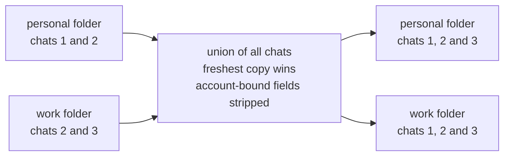

# Desktop chat sync

The Claude desktop app keeps its list of Code chats per account. Sign the app into
another account and the sidebar is empty, even though every conversation is still on
disk. `claude-accounts sync` copies each chat's record into every account's folder, so
every account lists every chat, with its full history.

This page covers what the app stores where, how sync decides what to copy, what it
leaves alone, and how to undo it. The rest of the design is in
[ARCHITECTURE.md](ARCHITECTURE.md).

## Where the desktop app keeps chats

```
~/Library/Application Support/Claude/
├── config.json                        lastKnownAccountUuid = the signed-in account
└── claude-code-sessions/
    └── <accountUuid>/
        └── <orgUuid>/
            ├── local_<id>.json        one record per chat
            ├── deleted_<id>           tombstone of a deleted chat
            ├── archived-sessions.idx  load-order hint
            ├── scheduled-tasks.json   desktop scheduled tasks
            └── backlog/  waiting-input/

~/.claude/projects/<folder named after the cwd>/<cliSessionId>.jsonl
                                       the conversation itself, shared by every account
```

Each chat is two files:

- **The record** - `local_<id>.json`, stored per account. One JSON object with
  `sessionId` (`local_<id>`), `cliSessionId`, `cwd`, `title`, `model`,
  `permissionMode`, `isArchived`, times in milliseconds (`createdAt`,
  `lastActivityAt`, `lastTurnEdgeAt`, `latestUserFrameAt`, `lastFocusedAt`) and many
  UI fields.
- **The conversation** - the Claude Code transcript `<cliSessionId>.jsonl` in the shared
  `~/.claude/projects` (see [account folders](ARCHITECTURE.md#account-folders)).

How the app treats these files. This was learned by reading the app's files and bundle
(Claude desktop 4.23118.1). It is not a documented interface.

- It reads the folder only at launch and when you switch accounts. There is no file
  watcher.
- While it runs, it keeps the signed-in account's records in memory and rewrites them.
  It never deletes files it does not know.
- Deleting a chat writes a tombstone `deleted_<id>` (its content is the time in
  milliseconds) and removes the transcript.
- `archived-sessions.idx` is only a load-order hint. `isArchived` inside the record is
  what counts.
- An account folder can hold more than one organization folder, because the app creates
  near-empty ones. The one with the `local_*.json` files is the real one. A CLI account
  folder's `.claude.json` has `oauthAccount.accountUuid` and
  `oauthAccount.organizationUuid`, which match these folder names.
- It skips session files over 10 MiB and refuses files with more than one hard link.

## Why chats vanish when you switch accounts

The record sits under the account's id, while the transcript sits in the shared projects
folder. When the app switches to another account it reads that account's folder, finds
no record for the chat, and leaves it out of the sidebar. Nothing is lost. Put a copy of
the record into the other account's folder and the chat shows up there with its full
history, because the transcript it points to is the same file.

## How sync works



Each run:

1. **Find the folders.** For every configured account, the chat folder named by its
   account and organization ids. They come from the config (`desktop_account_uuid`,
   `desktop_org_uuid`), else from the account's own `.claude.json`. If the organization
   is still unknown, the organization folder with the most chats is used. An account
   that uses the plain `~/.claude` login has no `.claude.json` of its own (the shared
   `~/.claude.json` can name another account), so it needs `desktop_account_uuid` in the
   config. The ids are the folder names under `claude-code-sessions` (letter case does not
   matter: sync uses the spelling on disk), and `claude-accounts sync --dry-run` names every
   account it could not match.
2. **Read what it understands.** Every `local_*.json` record and `deleted_*` tombstone.
   Anything that is not valid JSON, lacks the expected fields or is over 10 MiB is
   skipped and left untouched. A copy that would come out over 10 MiB (the target keeps
   its own account fields, so a copy can grow) is not written, and the run reports an
   error: the app would skip that file.
3. **Union.** A chat that exists in any account's folder should exist in all of them.
4. **Freshness.** When copies of one chat differ, the copy with the latest activity time
   wins. A rename, an archive or a model change leaves the activity time as it was, so
   when those are equal the copy whose content changed last wins. File times alone would
   mislead here: the app rewrites a record (its `lastFocusedAt`) whenever you open the
   chat, so an old copy you only looked at would look newest. Sync keeps a hash of each
   record's content without `lastFocusedAt`, and when it last changed, in `seen.json` in
   its state folder. While a record's content is unchanged, that remembered time stands.
   The first sync, with no `seen.json` yet, goes by file times.
5. **Strip account-bound fields.** claude.ai connectors and Remote Control belong to one
   account, so these fields are removed before a record is written into another account:
   `bridgeSessionIds`, `remoteMcpServersConfig`, `mcpConnectorsAsked`,
   `mcpConnectorsAskedOut`, `mcpToolsAskedOff`, and the `enabledMcpTools` entries keyed
   `<connectorUuid>:<tool>`. Entries starting with `local:` are machine-local and stay.
   When the app loads a record without these fields it uses the account's own. When sync
   updates a chat that the other account already lists, that account's own values for
   these fields are kept. The markers the app sets when it quits during a turn never
   travel at all (see [What is not synced](#what-is-not-synced)).
6. **Only additions in the running app's folder.** While the app runs it holds the
   signed-in account's records in memory and writes them back, so a change made under it
   would be overwritten or would fight with its state. Sync therefore only adds missing
   chats to that one folder. The app shows them after a restart, since it reads the
   folder at launch. Every other folder, and every folder while the app is closed, gets
   full updates.
7. **Deletions travel.** A deleted chat stays deleted: sync copies its tombstone to the
   other folders and moves their copies of the record to the trash, so the union can
   never bring it back. Like any other change, this waits for the running app's own
   folder until the app is closed.
8. **Old copies are kept for a while.** The first run that changes anything saves a
   backup tarball of the records and tombstones of every account in the config at that
   time. Any record sync replaces or removes is moved to a trash folder, which keeps the
   two newest copies of each file for up to 30 days and deletes older ones. New files are
   written to a temp name and renamed into place, as plain files with a single link.

Sync never edits `archived-sessions.idx`, `scheduled-tasks.json`, `backlog/`,
`waiting-input/` or any other file that is not a `local_*.json` record or a `deleted_*`
tombstone.

## Using it

```bash
claude-accounts sync --dry-run        # show what would change, write nothing
claude-accounts sync                  # sync once
claude-accounts sync install          # sync every 10 minutes in the background
claude-accounts sync install --every 5
claude-accounts sync status           # is the background job installed, when did it last run
claude-accounts sync uninstall        # stop the background job
```

`--json` prints a machine-readable report and `--quiet` prints nothing unless something
went wrong (the background job uses it). The background job is a per-user LaunchAgent,
so it runs only while you are logged in to your Mac. `sync install` also sets
`desktop_sync.enabled` to true in the config. With it on, the hook syncs right after a
handoff and `claude-accounts status` adds one `Desktop chats - ...` line. The job runs this
copy's `bin/claude-accounts` by its full path, so after you move or rename the repo folder
`sync status` says the job is BROKEN: run `claude-accounts sync install` again from the
new place.

## With a handoff

When a desktop chat hits its usage limit, the [StopFailure hook](ARCHITECTURE.md#the-stopfailure-hook)
continues it in a Terminal window on the next account right away. With sync enabled the
hook also syncs at once, so the chat is already in the next account's list. To go on in
the app instead, sign the app into that account (or restart it if it already is).

The Terminal continuation is a fork: it gets its own session id, and the app's copy of
the chat ends where the limit hit. Continue in one place only. If the Terminal session
already finished the task, the app chat does not show that work. It is in the fork's
transcript, which `claude --resume` lists.

## What is not synced

- **Desktop scheduled tasks** - each account keeps them in its own folder, and the app
  reads only the signed-in account's folder, so tasks saved under another account do not
  run while you use this one. Sync lists those tasks as a heads-up and never copies or
  edits them.
- **Cowork sessions** - not copied.
- **claude.ai web chats and connectors** - they live on Anthropic's servers, per account.
  Nothing on your Mac can move them.
- **A chat's connector choices and Remote Control link** - stripped, because they belong
  to one account (step 5 above).
- **Quit-resume markers** - when the app quits during a turn, it marks the chat so it can
  resume that turn at its next launch (`interruptedByQuitAt`, `interruptedUnseenResume`,
  `interruptedAwaitingPerson`, `interruptedByQuitFor`, `remoteControlLiveAtUpdateQuit`,
  `armedWorkAtQuit`). They stay in the folder that ran the turn, also when another
  organization folder of the same account gets the chat, so a second account never
  resumes the same turn again.

## How to undo it

- **Stop syncing** - `claude-accounts sync uninstall` removes the LaunchAgent and sets
  `desktop_sync.enabled` back to false. Chats that were already copied stay listed. They
  are the same chats, so leaving them is harmless.
- **Get back an older copy of a record** - copies sync replaced are in
  `desktop-sync/trash/<account id>/` inside the tool's state folder
  (`~/.config/claude-failover/state` by default), named `<file>.<unix time>`, two per file
  at most. Sync always spreads the freshest copy (step 4), so stop it first with
  `claude-accounts sync uninstall` (that also turns off the sync at handoff). Otherwise
  the next sync replaces the restored copy again, or the restored copy, which is now the
  newest file, replaces the other accounts' copies. Then quit the app, copy the file back
  under its original name into every account folder that should have that version, start
  the app, and run `claude-accounts sync install` again.
- **A record sync removed stays gone** - it belongs to a chat you deleted under another
  account. The app deleted its transcript at that time, and sync left a `deleted_<id>`
  tombstone next to the record, so copying the record back does not bring the chat back.
- **Put back the folders as they were before the first sync** - stop syncing, quit the
  app, then unpack the first-run backup from `desktop-sync/backups/` in the state folder:
  `tar -xzf <backup>.tar.gz -C ~/Library/Application\ Support/Claude/claude-code-sessions`.
  Every record and tombstone in it comes back as it was. Files sync added later (copied
  chats and tombstones) stay until you delete them.

## Caveats

- **Deleting a chat deletes it everywhere.** The app removes the transcript, which every
  account shares, and sync carries the tombstone to the other accounts. If you are not
  sure, archive the chat instead.
- **The app's internals can change between versions.** Sync copies only JSON records it
  understands, skips anything odd, and leaves every other file alone. If an app update
  changes the layout, sync does less. It does not guess.
- **New chats appear after a restart** in the folder of the account the app is using
  (step 6 above).
